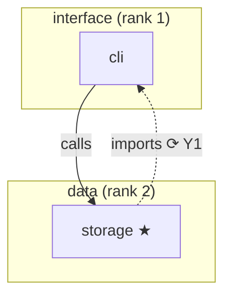

# Codemap

A codemap is the readable view of a codebase: what its parts are, at several levels, and how they
interact to keep the project running. It is **built from an audit record** ([[audit-record]]) and its
structure lens ([[audit-lens-structure]]). The record holds the evidence; the map presents it.
Keeping it current is [[codemap-upkeep]].

## 1. What it is for, and when to have one

People and agents read the map **before** they search the code: to find where a change belongs, what
it will touch, and which parts everything depends on.

| Have one when | Skip it when |
|---|---|
| The codebase has two or more subsystems | One small package that a directory listing explains |
| Agents or new people start work in it often | Only one person works on it and nothing changes shape |
| A refactor, split or rewrite is planned | The code is throwaway |

Prior art it draws on: the C4 model's zoom levels (context → containers → components → code), the
`ARCHITECTURE.md` codemap habit (a short, named tour of the parts, kept current a few times a year), and
tool-built repository maps (tree-sitter or ctags symbol trees ranked by how much they are used).

## 2. Rules

1. **One source: the latest record.** Every unit, relation and number in the map comes from the latest
   audit record in the audit folder (`audit_folder`, default `docs/audits`), full or scoped (a scoped record is complete on its own,
   [[audit-record]] §7). The map never states a fact the record doesn't hold. To change the map, change
   the record (re-audit), then rebuild.
2. **Pinned.** The map's header names the record's audit id and commit, so anyone can tell how old it is
   (`git diff --name-only <commit>..HEAD`).
3. **Same ids.** Units are named by their core ids, so a reader can go from the map to the record and
   back.
4. **Evidence kept.** Every interaction shown carries at least one evidence `path:line` from the record.
   `INFERRED` ones are marked.
5. **Generated, not edited.** The map is rebuilt whole from the record (§4). Hand edits are lost on the
   next rebuild; put corrections into the record instead.

## 3. Levels

The levels follow the core's unit kinds. A project shows levels down to `{{codemap_depth}}`; a level
can't go deeper than the record's `depth`.

| Level | Shows | Interactions shown | From the structure lens |
|---|---|---|---|
| **L0 System** | The system, its entry points, and every outside thing (data stores, services, config, key dependencies) | Which subsystem uses which outside thing (`reads`, `writes`, `sends`, `receives`, `depends-on`) | — |
| **L1 Subsystems** | Each subsystem with its purpose, grouped by layer | Relations between subsystems, rolled up (§3.2) | layers, boundaries, central units, cycles at subsystem level |
| **L2 Modules** | Modules inside each subsystem | Relations between modules, rolled up | central units, cycles at module level |
| **L3 Files** | Files inside each module (or subsystem when it has no modules) | Relations between files | central units, cycles at file level |
| **L4 Symbols** | Only the symbols the record lists | Relations between symbols | — |

A level with no units in the record (for example no `module` units) is left out with one line saying so.

### 3.1. What each level holds

Every level has the same two tables, in this order:

- **Units:** `id`, `purpose` (from the core), `parent`, and the marks below.
- **Interactions:** `from`, `to`, `types`, `count` (how many record relations were rolled into it),
  `evidence` (one example `path:line`; more stay in the record), `confidence`, and marks.

L0 and L1 also have a Mermaid diagram (§5). Deeper levels have a diagram only when they have 15 units or
fewer.

**Marks**, used in both tables:

| Mark | Means | Source |
|---|---|---|
| ★ | Central unit, with `fan-in/fan-out` | `central-units` |
| ⟳ Y*n* | Part of a dependency cycle | `cycles` |
| ↑ F*n* | Goes against the layering (a finding citing S2) | lens findings |
| ? | `INFERRED`, not confirmed | `confidence` |
| ⧉ B*n* | Inside a boundary the core lacks (process, deployable, ownership) | `boundaries` |

### 3.2. Rolling relations up

A relation between two units counts at every higher level where their ancestors differ. A file in `cli`
importing a file in `storage` also shows as `cli → storage` on L1.

- Group rolled-up relations by `from`, `to`; list each distinct `type` once and sum the `count`.
- An interaction is `CONFIRMED` if any relation in it is; otherwise `INFERRED`.
- Relations inside one unit (both ends under the same ancestor) don't show at that ancestor's level.
- Leave out `tests` relations except as a count in the Units table ("tested by 3 files"); test files
  themselves appear only in that count. Leave out relations to outside things below L0.
- A `calls` relation with `note: renders` (from [[audit-lens-ui]]) shows as type `renders`.

### 3.3. Layers and boundaries

- **Layers:** L1 lists subsystems by layer, highest rank first (rank 1 = top). With `layers: []` it
  says "No layering" and lists subsystems alphabetically. Layers that are `source: inferred` and not
  confirmed by the initiator are marked `?`.
- **Boundaries:** shown on L1 as groups (Mermaid subgraphs, and a Boundaries table: `id`, `kind`,
  `name`, `units`). They never replace subsystems; the core's `parent` still gives the tree.

## 4. Building the map

1. **Find the latest record** in the audit folder (`audit_folder`, default `docs/audits`): highest date, then latest commit. Check it has
   `protocol/audit-lens-structure` in its `lenses`. If it doesn't, run the lens first.
2. **Write the header** (§5) from `00_AUDIT.md`: audit id, commit, date, record path, depth shown.
3. **L0** from units of kind `system`, their `entry` fields, and `outside` with the relations into it.
4. **For each level** down to `{{codemap_depth}}`: list the units of that kind; roll relations up to it
   (§3.2); add the marks from the structure lens results.
5. **Not shown:** copy the record's gaps (core and structure lens) and note any level left out.
6. **Check** (§6), then save to `{{codemap_file}}`.

An agent can build the map by hand from the record. A generator script may do it later; it follows the
same steps and is listed in the map's header under `built-by`.

## 5. Format

One Markdown file at `{{codemap_file}}`:

````markdown
---
type: codemap
audit-id: <record audit id>
commit: <record commit, short>
record: "<path to the record folder>"
date: <record date>
depth: <deepest level shown>
built-by: "<who or what built it>"
---

# <repo> codemap

Built from audit <audit-id> at commit <commit>. To check freshness:
`git diff --name-only <commit>..HEAD`

## L0 System
## L1 Subsystems
## L2 Modules
## L3 Files
## L4 Symbols
## Not shown
````

- **Diagrams:** Mermaid `flowchart TD`; layers top to bottom by rank; boundaries as subgraphs; edge
  labels are the interaction types; cycle and upward edges dotted. Tables carry the same facts, so the
  map still reads where Mermaid doesn't render.
- **Splitting:** when the file passes 40,000 characters (`wc -m`), L2 and below move to one file per
  subsystem next to it (`docs/codemap/<subsystem>.md`, same header). The main file keeps L0, L1, Not
  shown and links to each part.

## 6. Done when

- [ ] The header's audit id and commit match the latest record.
- [ ] Every unit and relation shown exists in that record; no id is invented.
- [ ] Every interaction has evidence; `INFERRED` ones are marked.
- [ ] Layers, boundaries, central units and cycles match the structure lens results.
- [ ] The record's gaps are under Not shown.
- [ ] No level is deeper than the record's depth or `{{codemap_depth}}`.

## 7. Out of scope

- **How a project's agents load the map** (hooks, imports, session start). The project decides.
- **Keeping it current:** [[codemap-upkeep]].
- **The generator tool:** a later, optional `tool/` item.

## 8. Example

Built from the `notes-cli` record in [[audit-record]] §8 with the structure lens example in
[[audit-lens-structure]] §6 (relations `R6`, `R7`, layers declared in the README, cycle `Y1`). The record
has no `module` units, so L2 is left out.

````markdown
---
type: codemap
audit-id: 2026-11-12-a1b2c3d
commit: a1b2c3d
record: "docs/audits/2026-11-12-a1b2c3d/"
date: 2026-11-12
depth: file
built-by: "Claude Code (claude-opus-5-5), by hand"
---

# notes-cli codemap

Built from audit 2026-11-12-a1b2c3d at commit a1b2c3d. To check freshness:
`git diff --name-only a1b2c3d..HEAD`

## L0 System
**notes-cli**: CLI note taker with a SQLite store. Entry: `src/notes/__main__.py:1`.

| Outside | Kind | Used by | Type | Evidence | Confidence |
|---|---|---|---|---|---|
| X1 SQLite database file | data-store | storage | writes | `src/notes/storage/db.py:88` | CONFIRMED |
| X2 `~/.notes.toml` | config | cli | reads | `src/notes/cli/config.py:9` | ? INFERRED |

## L1 Subsystems



| Layer | Unit | Purpose | Marks |
|---|---|---|---|
| interface | cli | Parses arguments and runs commands | ⟳ Y1 |
| data | storage | Stores and queries notes in SQLite | ★ 1/1, ⟳ Y1 |

| From | To | Types | Count | Evidence | Confidence | Marks |
|---|---|---|---|---|---|---|
| cli | storage | calls, imports | 2 | `src/notes/cli/commands.py:42` | CONFIRMED | ⟳ Y1 |
| storage | cli | imports | 2 | `src/notes/storage/db.py:5` | CONFIRMED | ⟳ Y1, ↑ F2 |

Boundaries: none.

## L2 Modules
No module units in the record.

## L3 Files

| Unit | Parent | Purpose | Marks |
|---|---|---|---|
| src/notes/cli/commands.py | cli | One function per command | |
| src/notes/cli/format.py | cli | Note formatting helpers | |
| src/notes/storage/db.py | storage | NoteStore class, schema migrations, note formatting | ★ 1/1; tested by 1 file |

| From | To | Types | Count | Evidence | Confidence | Marks |
|---|---|---|---|---|---|---|
| src/notes/cli/commands.py | src/notes/storage/db.py | imports | 1 | `src/notes/cli/commands.py:3` | CONFIRMED | |
| src/notes/storage/db.py | src/notes/cli/format.py | imports | 1 | `src/notes/storage/db.py:5` | CONFIRMED | ↑ F2 |

## Not shown
- G1 `src/notes/plugins/`: plugins load by name from config at runtime; their relations aren't mapped.
- L2 Modules and L4 Symbols: not in the record.
````

## Changelog

### [Unreleased]
#### Added
- First draft: five levels from the core's unit kinds, roll-up rules, marks from the structure lens,
  build steps, single-file format with a split rule, and a worked example from the `notes-cli` record.
