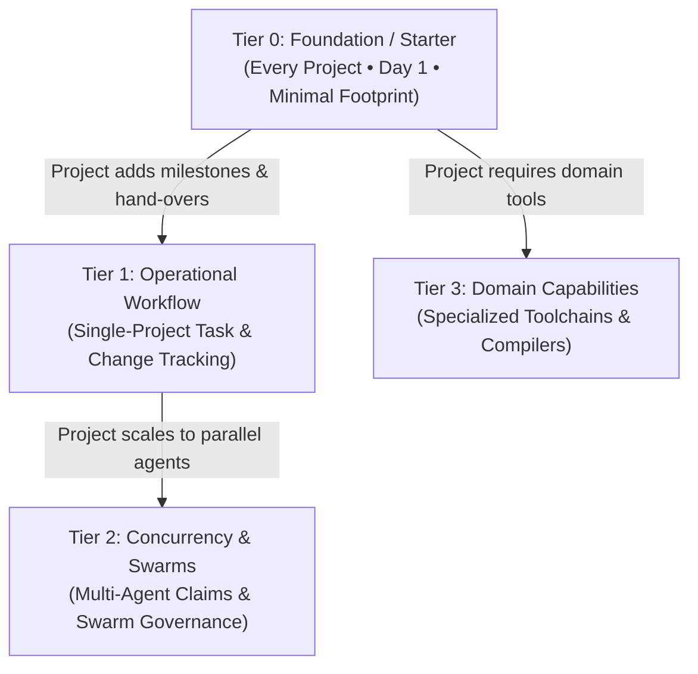

# Progressive Context Disclosure: Preventing Instruction Bloat in AI Agent Workspaces

> **Executive Summary:** Injecting an entire catalog of agentic protocols, conventions, and tools into a project on Day 1 is an anti-pattern known as **instruction bloat**. Following the [[research-discipline]] protocol, this document synthesizes primary empirical benchmarks, vendor architecture guidelines (Anthropic, Cursor, OpenAI), and software engineering first principles (YAGNI, progressive disclosure) to establish a **Tiered Context Hierarchy** and a **Profiles (Loadouts)** system for the AI Agent Warehouse.

Related documents:
- Architectural foundation: [[warehouse-architecture]]
- Multi-agent orchestration and cost scaling: [[codebuff-orchestration]]
- Research discipline and evidence hierarchy: [[research-discipline]]

---

## 1. The Core Problem: Instruction Bloat & Context Rot

When onboarding a new repository or vault to the warehouse, a naive approach is to sync all compatible protocols, conventions, and tools at once. In our pilot audit of `doc-scanner` (a single-developer Python/OpenCV desktop tool), an uncurated sync proposed dumping **12 items totaling over 2,500 lines (>20,000 tokens)** into a project whose historical AI setup required only **two files (134 lines, ~1,100 tokens)**.

This massive overhead triggers well-documented degradation modes across transformer-based agents:

### Symptoms of Instruction Bloat

| Symptom | Mechanism | Impact on Agent Operations |
|---|---|---|
| **Attention Dilution ("Lost in the Middle")** | Transformer attention weights are finite. As irrelevant tokens saturate prompt context, the relative attention allocated to core technical constraints drops. | The agent ignores project-specific invariants (e.g., coordinate normalization) to satisfy irrelevant boilerplate. |
| **Quadratic Cost Multiplier** | LLM inference resends cached/system context on every tool call and turn. | A 20K-token system context across a 60-turn troubleshooting session adds **1.2 million redundant input tokens** to inference cost and doubles response latency. |
| **Instruction Fatigue & Reversion** | Conflicting or overwhelming procedural rules create contradictory optimization targets. | The agent enters infinite reasoning loops or silently reverts working code when trying to satisfy passive rules meant for other domains. |
| **Search Space Pollution** | Auxiliary tools and protocols add dozens of markdown files to the project tree. | Agent file search tools (`find_by_name`, `grep_search`) return extraneous matches from unused protocols rather than actual source code. |

---

## 2. Research Evidence (The Provenance Ladder)

Following the [[research-discipline]] Provenance Ladder, this architecture is grounded in verified evidence across three rungs:

### Rung 1: Primary Source Data & Codebase Audit
An inspection of `C:\projects\my-app\` reveals:
* **Active Working Set:** `AI/00_AGENT_PROTOCOL.md` (71 lines) and `AI/Obsidian_As_Working_Memory.md` (63 lines).
* **Actual Needs:** Pure local image processing boundaries (zero cloud APIs, normalized $[0.0, 1.0]$ coordinates, local temp cache) and basic working memory (disk = RAM).
* **Unneeded Dead Weight in 12-Item Dump:**
  - `protocol/worktree-claims` (multi-agent concurrent branch claims — useless in a solo workspace).
  - `tool/tex-compile` & `skill/latex-pdf` (LaTeX toolchains in an OpenCV image scanner).
  - `tool/backlog-cli` & `skill/backlog-governance` (CLI task claims when a native `BACKLOGS.md` markdown checklist is already used).
  - `architecture/codebuff-orchestration` (swarm orchestration rules for a single-agent session).

### Rung 2: Empirical Measurements & Academic Literature
* **Liu et al. ("Lost in the Middle: How Language Models Use Long Contexts"):** Models demonstrate high recall at the beginning and end of context windows, with recall plummeting by up to 40% for instructions embedded in dense intermediate text.
* **Token Cost Analysis:** Re-sending 25K passive tokens per interaction in multi-turn coding sessions accounts for **>60% of cumulative API spend** without contributing to solution quality.

### Rung 3: Authoritative Vendor Specifications & Architecture
* **Anthropic Agent Architecture:**
  > *"Progressive disclosure is an information architecture pattern where complexity is revealed only when necessary... Only include information in the primary context that is needed for every turn; move specialized instructions or reference manuals to secondary files that the agent can retrieve on-demand."*
* **Cursor Scoped Rules (`.cursor/rules/*.mdc`):**
  Cursor deprecates monolithic, always-applied `AGENTS.md` instructions in monorepos due to severe context bloat. They enforce **scoped rule loading** based on file globs and active task intents.

---

## 3. The Tiered Context Hierarchy

Information architecture for agent workspaces must mirror the tiered compute model: start with the absolute minimum viable operating posture, unlocking higher operational complexity only as project demands expand.



### Tier Definitions

#### Tier 0: Foundation / Starter (Minimal Viable Posture)
* **Goal:** Prevent rogue agent behavior, context amnesia, and destructive writes with zero token waste.
* **When to adopt:** **Day 1 of any project or vault.**
* **Items:**
  1. `protocol/agent-protocol`: Core working posture (verify before claiming success, touch only what is asked, surface assumptions).
  2. `protocol/working-memory`: Context management methodology (disk is memory, context window is RAM).

#### Tier 1: Operational Workflow (Structured Projects)
* **Goal:** Establish structured milestone tracking, clean git history, and persistent hand-overs across sessions.
* **When to adopt:** When a project expands beyond quick prototypes to multi-session features, release cycles, or team hand-overs.
* **Items:**
  - *All of Tier 0*, plus:
  3. `convention/commits`: Conventional atomic commit messages.
  4. `convention/backlog`: Structured task tracking and acceptance criteria.
  5. `protocol/session-log`: Session hand-over notes and decision records.
  6. `protocol/safe-write`: Guardrails for modifying live stores/databases.

#### Tier 2: Concurrency & Scaling (Multi-Agent Swarms)
* **Goal:** Prevent merge collisions, race conditions, and coordination overhead across concurrent agent instances.
* **When to adopt:** When multiple agents (or humans + agents) work in parallel worktrees simultaneously.
* **Items:**
  - *All of Tier 1*, plus:
  7. `protocol/worktree-claims`: Atomic branch claims and reservation locks.
  8. `tool/backlog-cli`: Programmatic task claiming and ID allocation CLI.
  9. `skill/backlog-governance`: Backlog grooming and status transition skill.
  10. `architecture/codebuff-orchestration`: Multi-agent role hierarchy (orchestrator, subagents, reviewer).

#### Tier 3: Domain-Specialized Capabilities
* **Goal:** Equip the project with domain-specific compilers, linters, or external APIs.
* **When to adopt:** Strictly on demand when the project's technical domain matches.
* **Items:**
  - `tool/tex-compile` & `skill/latex-pdf`: Academic vaults and mathematical paper authoring.
  - Future domain loadouts (e.g. Google Sheets automation, computer vision batch tools).

---

## 4. Profiles as Loadouts: Architecture & Mechanics

To make tiered progressive disclosure operational and repeatable, the warehouse implements **Profiles** (loadouts).

A **Profile** is a curated, named YAML manifest defining a cohesive cluster of warehouse items, their version pins, and recommended default settings.

### 4.1 Storage Standard
Profiles are stored in the warehouse at `<warehouse>/profiles/<name>.yml`:

```yaml
name: starter
description: Minimal viable operating posture (Tier 0). Prevents hallucination and reckless writes with zero bloat.
tier: 0
applies-to: [vault, codebase]
items:
  - protocol/agent-protocol@0.1
  - protocol/working-memory@0.1
settings: {}
```

### 4.2 Standard Catalog Profiles

| Profile Name | Tier | Primary Items Included | Target Projects |
|---|---|---|---|
| **`starter`** | 0 | `protocol/agent-protocol`, `protocol/working-memory` | Default for all new projects and lean codebases (`doc-scanner`). |
| **`standard`** | 1 | `starter` + `convention/commits`, `convention/backlog`, `protocol/session-log`, `protocol/safe-write` | Active feature repos, production apps, long-running projects. |
| **`concurrency`** | 2 | `standard` + `protocol/worktree-claims`, `tool/backlog-cli`, `skill/backlog-governance`, `architecture/codebuff-orchestration` | Multi-agent swarms, complex monorepos, concurrent worktree pipelines. |
| **`academic`** | 3 | `starter` + `tool/tex-compile`, `skill/latex-pdf` | Academic vaults, math/physics notes, publication pipelines (`COLLEGE`). |

### 4.3 Profile Lifecycle Operations (`warehouse profile`)

The warehouse CLI provides commands to inspect, author, modify, delete, and slot profiles into project manifests:

* **Listing Profiles:**
  ```powershell
  python _tools/warehouse.py profile list
  ```
  Lists all profiles sorted by Tier with their descriptions and item counts. Supports `--json`.

* **Viewing Profile Details:**
  ```powershell
  python _tools/warehouse.py profile show starter
  ```
  Displays the full specification, items with pins, and declared settings.

* **Saving / Creating / Modifying a Profile:**
  ```powershell
  # Save a custom loadout directly
  python _tools/warehouse.py profile save data-science --tier 1 --description "Data science scripts" --items protocol/agent-protocol@0.1,protocol/safe-write@0.1

  # Capture the current project's active manifest into a reusable profile
  python _tools/warehouse.py profile save my-custom-loadout --from-manifest --description "Custom vault loadout"
  ```

* **Applying a Profile to an Existing Project:**
  ```powershell
  # Slots the profile's items into the project's .warehouse.yml
  python _tools/warehouse.py profile apply standard
  ```

* **Deleting a Profile:**
  ```powershell
  python _tools/warehouse.py profile delete custom-loadout --yes
  ```

---

## 5. Integration with Project Bootstrapping

Prior to progressive disclosure, `warehouse bootstrap` scanned the catalog and emitted every item whose `applies-to` matched the project type. 

With profile integration:
1. **Default to Starter:** `warehouse bootstrap` defaults to `--profile starter`, emitting only Tier 0 items.
2. **Explicit Profiles:** A project owner or agent can specify `--profile standard`, `--profile academic`, or any custom profile name.
3. **Exhaustive Mode:** `--profile all` remains available for full catalog scans when explicitly requested.

### Example: Bootstrapping `doc-scanner`
```powershell
# In C:\projects\my-app\
python <warehouse>\_tools\warehouse.py bootstrap --write
```
Produces lean, non-bloated `.warehouse.yml`:
```yaml
auto_sync: true
target: warehouse/
items:
  - protocol/agent-protocol@0.1
  - protocol/working-memory@0.1
```

---

## 6. Coexistence Strategy: `warehouse/` vs `AI/`

When migrating a legacy project to the warehouse:

1. **`warehouse/` is the standard library:**
   - Synced, read-only items managed by `.warehouse.lock`.
   - Never modified directly inside the project; updated via `warehouse pull` or upstream releases.
2. **`AI/` is project-owned space:**
   - Holds project-specific domain workflows (e.g. `doc_scanner_invariants.md`, Google Sheets API keys/endpoints).
   - Holds the project's local session logs (`AI/session/`).
3. **Phasing out duplicated legacy files:**
   - Generic legacy files like `00_AGENT_PROTOCOL.md` or `Obsidian_As_Working_Memory.md` are safely retired once their canonical warehouse versions are synced to `warehouse/`.
   - The project's root `CLAUDE.md` or `AGENTS.md` is updated to point to `warehouse/README.md` for standard rules, while retaining unique domain invariants.
